# Mihenk

<p align="center"></p>

Mihenk; kişiselleştirilmiş kitap önerileri, kitaplık yönetimi, okuma takibi,
alıntılar ve fiyat alarmları sunan bir web uygulamasıdır. Telefona uygulama
gibi kurulabilir (PWA) ve arkadaşlarla birlikte okumak ya da ders çalışmak için
canlı odalar sunar.

## Özellikler

- **Ruh hâline göre öneri:** "Yağmurlu bir akşam için kısa ve gizemli bir şey"
  gibi serbest bir cümleden, karakter, tema ve okuma geçmişine göre sıralanmış
  öneriler ve her önerinin neden uygun olduğu.
- **Kitaplık ve okuma takibi:** okuyorum / okuyacağım / okudum rafları, sayfa
  ilerlemesi, kişisel kitaplar, barkodla (ISBN) kitap ekleme ve Goodreads içe
  aktarma.
- **Odak modu:** Pomodoro sayacıyla okuma seansları, okurken alıntı kaydetme,
  okuma hızı ve toplam süre.
- **Rozetler ve okuma takvimi:** seriler, seviyeler, yıllık hedef ve rozet
  vitrini; yeni kazanılan rozet konfeti ve paylaşılabilir kartla kutlanır.
- **Yıllık okuma özeti (`/ozet`):** okunan sayfalar, en sevilen tür, en uzun
  seri ve okur tipi; hikâye formatında kart kart paylaşılır.
- **Alıntı kartları (`/alintilar`):** kitaptan alıntıyı kapağın renkleriyle
  hikâye ya da gönderi boyutunda görsele çevirip paylaşma.
- **Topluluk:** kitaplara puan ve yorum, spoiler gizleme, faydalı bulma ve
  okurları takip etme.
- **Kitap kulüpleri:** ortak kitap, spoiler korumalı tartışmalar, ortak
  ilerleme, etkinlikler, oylamalar ve okuma odası.
- **Canlı odalar (`/odalar`):** arkadaşlarla aynı anda okuma ya da ders
  çalışma. Ayrıntılar aşağıda.
- **Kitap asistanı:** yapay zekâ destekli sohbet; rafa ekleme gibi işlemleri
  yalnızca kullanıcının onayıyla yapar.
- **Fiyatlar ve alarmlar:** mağaza fiyat karşılaştırması ve hedef fiyata
  düşünce bildirim.
- **Bildirimler ve hatırlatmalar:** uygulama içi bildirimler ve web push ile
  okuma hatırlatmaları.
- **Yönetim paneli (`/yonetim`):** kullanıcılar, yorum şikâyetleri, katalog,
  fiyat hattı ve kalite değerlendirmesi.
- **Gizlilik:** verileri indirme ve hesabı silme Ayarlar'dan yapılır.

## Ekran görüntüleri

Görüntüler örnek bir okur hesabıyla yerel sunucudan alındı; kitap kapakları
test kataloğunda üretilmiş kapaklardır.

<table>
  <tr>
    <td width="50%" valign="top">
      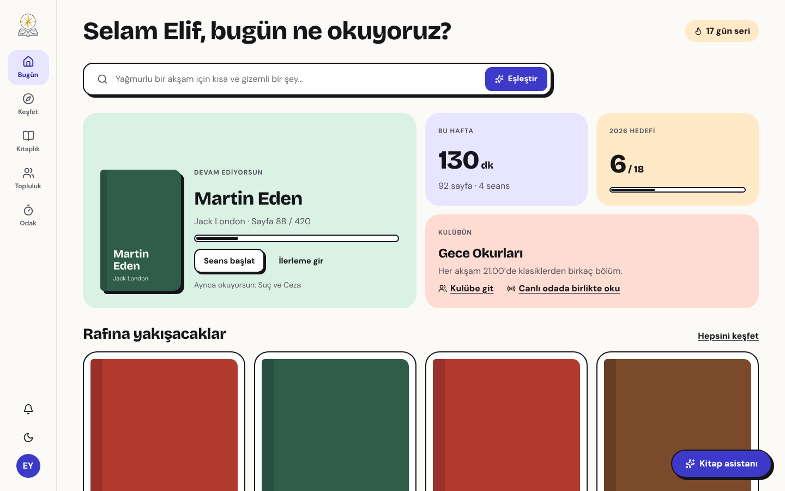<br>
      <b>Bugün</b><br>
      Günün başlangıç ekranı: kaldığın kitap ve ilerleme çubuğu, haftalık okuma süresi, yıllık hedef, kulübün ve “Canlı odada birlikte oku” kısayolu. Altında rafına göre seçilmiş öneriler.
    </td>
    <td width="50%" valign="top">
      <br>
      <b>Keşfet</b><br>
      Ne okumak istediğini kendi cümlenle yazarsın; her kitap bir uyum yüzdesi ve “neden sana uygun” açıklamasıyla listelenir. Üstteki şerit, sonucun profilindeki hangi sinyallerle ağırlıklandırıldığını söyler.
    </td>
  </tr>
  <tr>
    <td width="50%" valign="top">
      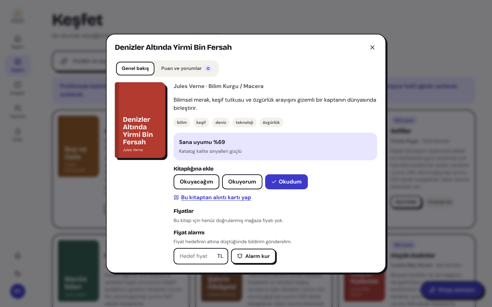<br>
      <b>Kitap ayrıntısı</b><br>
      Kitabın konusu, türü, temaları ve sana uyum puanı. Buradan rafa eklenir, alıntı kartı başlatılır, mağaza fiyatları karşılaştırılır ve hedef fiyat için alarm kurulur.
    </td>
    <td width="50%" valign="top">
      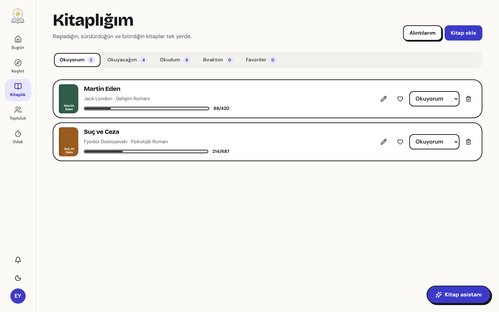<br>
      <b>Kitaplığım</b><br>
      Okuyorum, okuyacağım, okudum, bıraktım ve favoriler rafları. Her kitapta sayfa ilerlemesi ve raf değiştirme; “Kitap ekle” ile katalogdan, barkoddan ya da elle kitap eklenir.
    </td>
  </tr>
  <tr>
    <td width="50%" valign="top">
      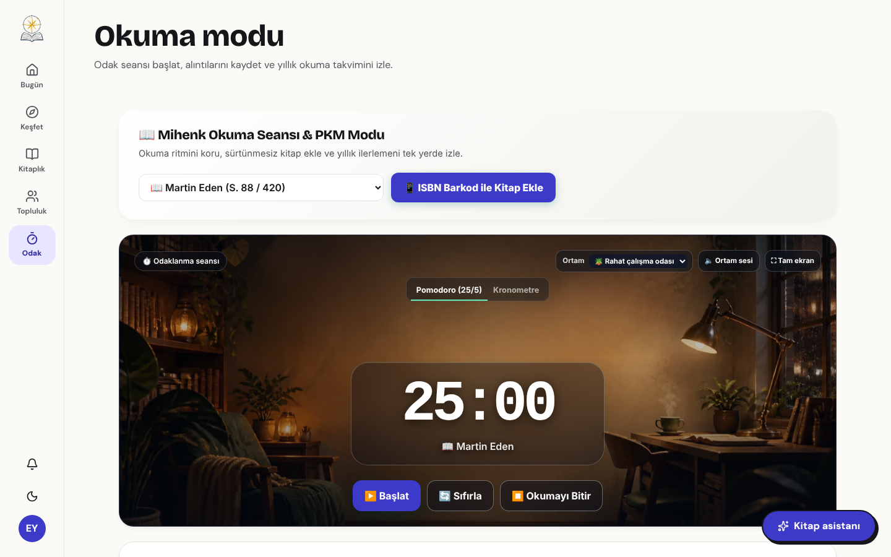<br>
      <b>Okuma modu</b><br>
      Pomodoro ya da kronometreyle okuma seansı; ortam sesi ve tema seçimi, tam ekran. Seans bitince okunan sayfalar takvime, serilere ve rozetlere işlenir.
    </td>
    <td width="50%" valign="top">
      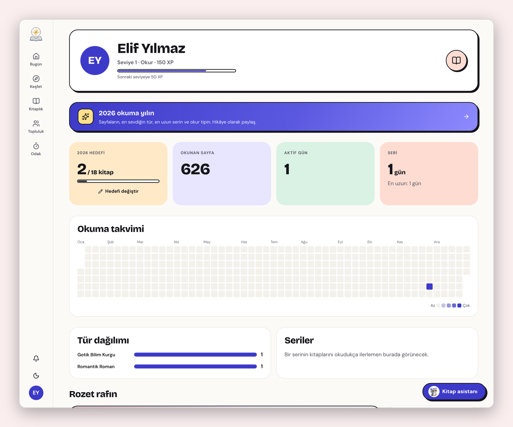<br>
      <b>Profil</b><br>
      Seviye ve deneyim puanı, yıllık hedef, okunan sayfa, aktif gün ve seri kartları; yılın her gününü gösteren okuma takvimi, tür dağılımı ve rozet rafı.
    </td>
  </tr>
  <tr>
    <td width="50%" valign="top">
      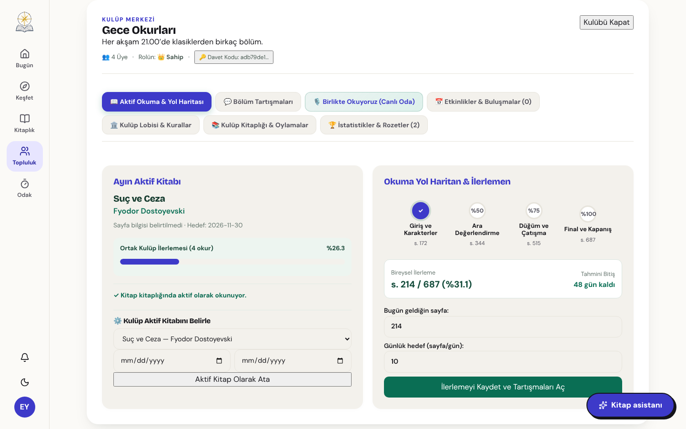<br>
      <b>Kitap kulübü</b><br>
      Ayın kitabı, ortak ilerleme ve okuma yol haritası. Sekmelerde spoiler korumalı tartışmalar, kulüp okuma odası, etkinlikler, oylamalar ve istatistikler bulunur.
    </td>
    <td width="50%" valign="top">
      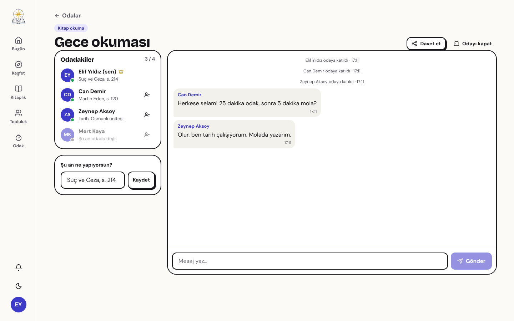<br>
      <b>Canlı oda</b><br>
      Kamera ve mikrofon olmadan birlikte okuma ya da ders çalışma. Solda o an odada olanlar ve ne yaptıkları, sağda giriş ve çıkışların da yazıldığı sohbet.
    </td>
  </tr>
  <tr>
    <td width="50%" valign="top">
      <br>
      <b>Yıllık okuma özeti</b><br>
      Yılın okuma hikâyesi kart kart: toplam sayfa, en sevilen tür, en uzun seri, en verimli ay ve okur tipi. Her kart paylaşılabilir görsele dönüşür.
    </td>
    <td width="50%" valign="top">
      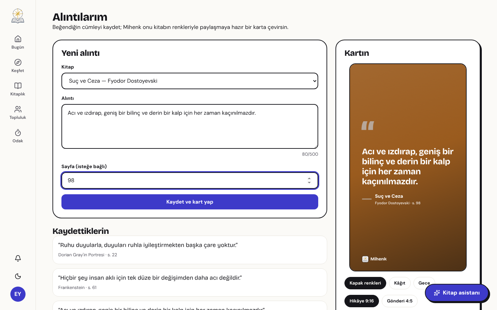<br>
      <b>Alıntı kartı</b><br>
      Alıntıyı yazarken sağda kart canlı olarak oluşur; renkler kitabın kapağından alınır. Hikâye ya da gönderi boyutunda indirilir veya paylaşılır.
    </td>
  </tr>
  <tr>
    <td width="50%" valign="top">
      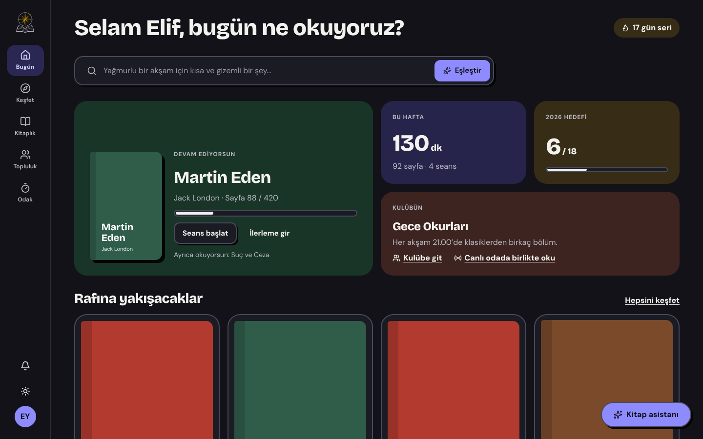<br>
      <b>Koyu tema</b><br>
      Tüm ekranlar açık ve koyu temada çalışır; varsayılan olarak cihazın ayarı izlenir, Ayarlar’dan değiştirilebilir.
    </td>
    <td width="50%" valign="top">
      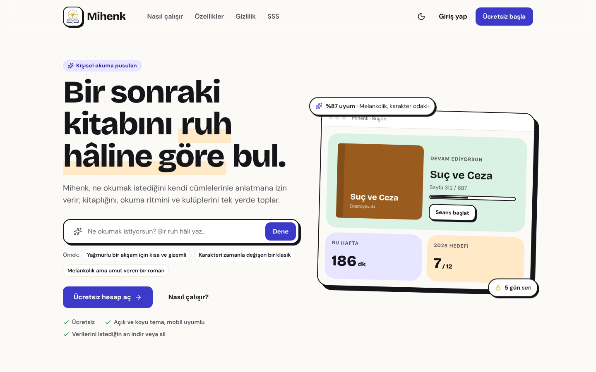<br>
      <b>Tanıtım sayfası</b><br>
      Giriş yapmamış ziyaretçinin gördüğü sayfa. Hesap açmadan ruh hâline göre örnek öneri denenebilir.
    </td>
  </tr>
</table>

## Telefonda uygulama olarak kullanma (PWA)

Mihenk ayrı bir mağaza uygulaması gerektirmeden telefonun ana ekranına
eklenebilir. Tam ekran açılır, kısayollarla (Bugün, Keşfet, Kitaplığım, Okuma
modu) başlatılır, bağlantı zayıfken de uygulama kabuğu açılır ve web push
bildirimleri gelir.

- **Android / bilgisayar (Chrome, Edge, Samsung Internet):** Bugün ekranındaki
  "Mihenk'i ana ekranına ekle" kartından ya da tarayıcı menüsündeki
  "Uygulamayı yükle" seçeneğinden.
- **iPhone / iPad (Safari):** Paylaş › Ana Ekrana Ekle. Uygulama bu adımları
  kartta ve Ayarlar › Uygulama olarak kullan bölümünde gösterir.

Servis çalışanı sitenin kökünden (`/service-worker.js`) sunulur ve tüm
sayfaları kontrol eder. Manifest `backend/app/static/manifest.webmanifest`
dosyasındadır.

Telefon görüntüleri 390×844 boyutunda, Android ve iPhone tarayıcısıyla alındı.

<table>
  <tr>
    <td width="50%" valign="top">
      <br>
      <b>Android: tek dokunuşla kurulum</b><br>
      Chrome, Edge ve Samsung Internet’te Bugün ekranında kart çıkar; “Yükle” tarayıcının kendi kurulum penceresini açar. Kart kapatılırsa 30 gün gösterilmez.
    </td>
    <td width="50%" valign="top">
      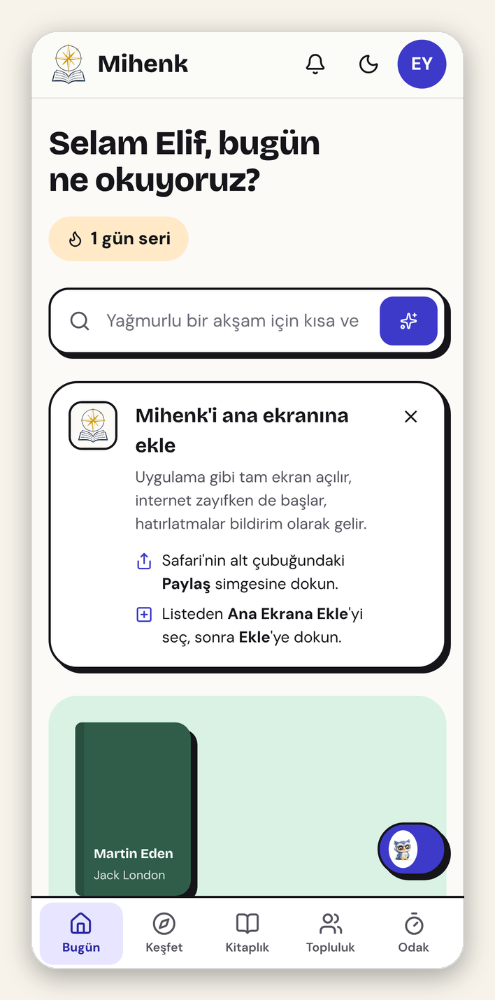<br>
      <b>iPhone: Ana Ekrana Ekle</b><br>
      Safari kurulum penceresi sunmadığı için kart iki adımı gösterir: Paylaş simgesi, ardından Ana Ekrana Ekle.
    </td>
  </tr>
  <tr>
    <td width="50%" valign="top">
      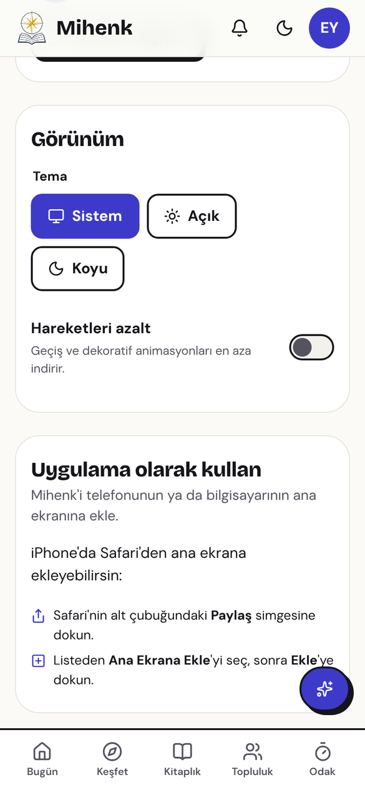<br>
      <b>Ayarlar › Uygulama olarak kullan</b><br>
      Kurulum durumu her zaman buradadır: yüklüyse bunu söyler, değilse cihaza uygun yolu anlatır.
    </td>
    <td width="50%" valign="top">
      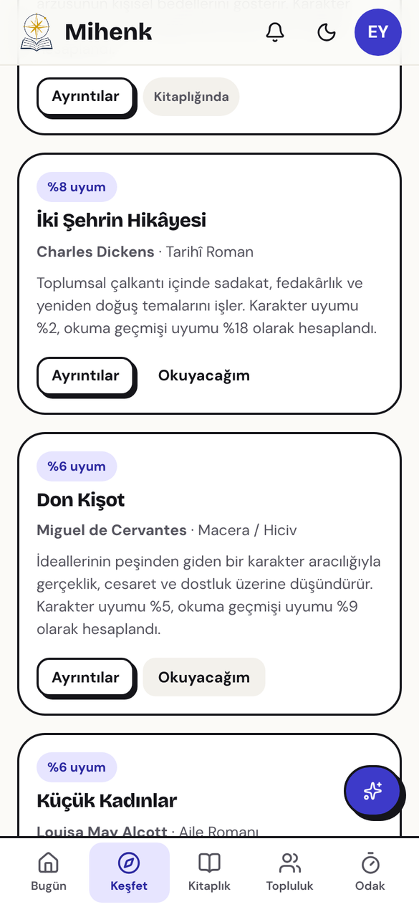<br>
      <b>Telefonda Keşfet</b><br>
      Öneriler tek sütunda; alt gezinme çubuğuyla Bugün, Keşfet, Kitaplık, Topluluk ve Odak arasında geçilir.
    </td>
  </tr>
  <tr>
    <td width="50%" valign="top">
      <br>
      <b>Telefonda okuma modu</b><br>
      Kitap seçimi, barkodla kitap ekleme ve ortam ayarları; sayaç tam ekranda telefonu okuma saatine çevirir.
    </td>
    <td width="50%" valign="top">
      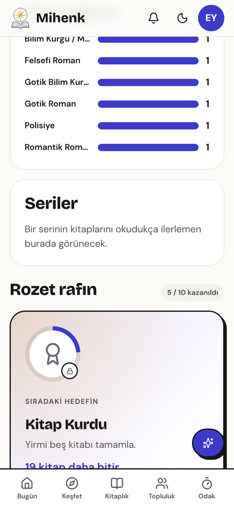<br>
      <b>Rozet rafı</b><br>
      Kazanılan ve sıradaki rozetler, ne kadar kaldığıyla birlikte.
    </td>
  </tr>
  <tr>
    <td width="50%" valign="top">
      <br>
      <b>Telefonda canlı oda</b><br>
      Katılımcılar üstte kısa bir liste, altında sohbet. Yüzen asistan düğmesi bu ekranda gizlenir ki mesaj kutusunu örtmesin.
    </td>
    <td width="50%"></td>
  </tr>
</table>

iPhone’da bilmen gerekenler:

- Bildirimler iOS 16.4 ve sonrasında, yalnızca ana ekrana eklenmiş uygulamada
  gelir; Safari sekmesinde gelmez.
- Uygulama kapalıyken arka planda veri eşitlenmez.
- Uzun süre açılmayan sitelerin önbelleğini Safari silebilir; oturum sunucuda
  tutulduğu için en fazla yeniden giriş istenir.

## Canlı odalar

Kamera ve mikrofon yoktur. Oda açan kişi bir ad ve tür seçer (kitap okuma,
ders çalışma ya da diğer), davet bağlantısını ya da 8 haneli kodu
arkadaşlarına gönderir.

- Katılımcı listesi o an odada olanları ve her kişinin ne yaptığını
  ("Fizik, 3. ünite" gibi) gösterir.
- Sohbette giriş ve çıkışlar otomatik olarak yazılır.
- Sayfa birkaç saniyede bir odanın durumunu yeniler; bu istek aynı zamanda
  "buradayım" sinyalidir. Sekme arka plandayken yenileme durur.
- Odayı açan kişi katılımcıyı çıkarabilir (çıkarılan kişi geri dönemez) ve
  odayı kapatabilir.

Adresler: `/odalar` odaların listesi, `/odalar?davet=KOD` davetle katılma,
`/odalar?oda=ID` oda ekranı. API `/me/live-rooms` altındadır.

## Sistem mimarisi

Mihenk tek bir Docker imajıdır: FastAPI sunucusu hem API'yi hem de derlenmiş
React uygulamasını aynı adresten sunar. Canlıda Render'da (Frankfurt) çalışır;
veriler ve kimlik doğrulama Supabase'de, hız sınırı ve metrikler Redis'te
tutulur. Yapay zekâ, katalog, e-posta ve fiyat kaynakları dış servislerdir;
zamanlanmış işler GitHub Actions ve n8n üzerinden çalışır.

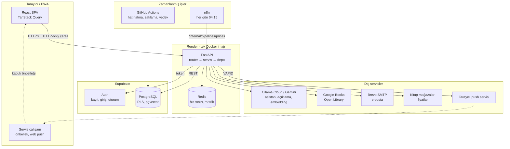

| Bileşen | Görevi | Kod |
| --- | --- | --- |
| React SPA | Tüm ekranlar; sunucu verisini TanStack Query ile önbelleğe alır ve yeniler | `frontend/src/spa`, `frontend/src/features` |
| Servis çalışanı ve manifest | Ana ekrana kurulum, uygulama kabuğunun önbelleği, web push bildirimleri | `backend/app/static/service-worker.js`, `manifest.webmanifest` |
| FastAPI | API, güvenlik katmanı (köken denetimi, hız sınırı), SPA'nın sunulması | `backend/app/main.py`, `backend/app/routers` |
| Servisler | Öneri ve arama, yapay zekâ, katalog, fiyat, okuma ve bildirim mantığı | `backend/app/services` |
| Depo katmanı | 13 alanlı veri sözleşmesi; yerelde SQLite, canlıda Supabase | `backend/app/repositories` |
| Supabase | PostgreSQL, satır düzeyinde güvenlik (RLS), kimlik doğrulama, vektör arama | `backend/supabase/migrations` |
| Redis | Dağıtık hız sınırı, e-posta gönderim koruması, metrikler | `backend/app/services/common/security.py` |
| n8n | Günlük fiyat hattını tetikler | `infra/n8n` |
| GitHub Actions | Test ve güvenlik taraması, hatırlatmalar, veri saklama, şifreli yedek, imaj yayını | `.github/workflows` |

### Sunucunun katmanları

Her istek aynı yoldan geçer. Router'lar yalnızca HTTP ile ilgilenir; iş
kuralları servislerde, veri erişimi depo katmanındadır. Depo katmanı bir
sözleşmeye (`contracts.py`) bağlıdır: aynı kod yerelde SQLite ile, canlıda
Supabase ile çalışır ve iki uygulama da aynı sözleşme testlerinden geçer.

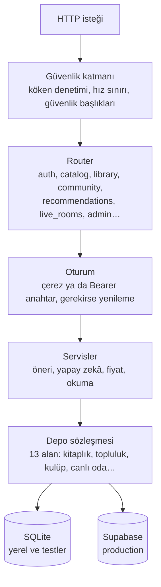

### Bir öneri isteğinin yolu

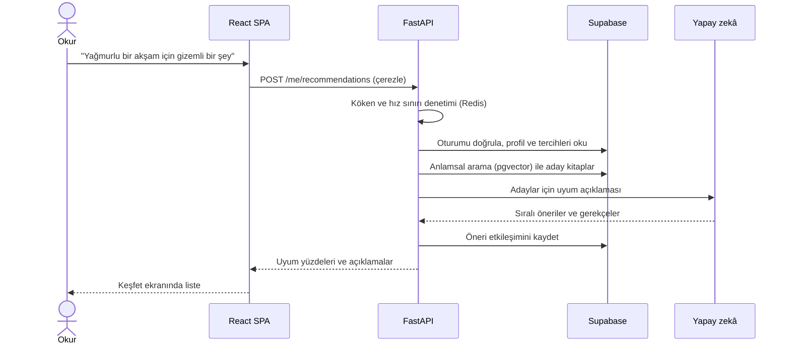

Yapay zekâ sağlayıcısına ulaşılamazsa sunucu yapay zekâsız açıklamaya geçer;
öneri listesi yine döner.

### Oturum ve güvenlik

- **Web:** Giriş Supabase Auth ile yapılır; erişim ve yenileme anahtarları
  tarayıcıda yalnızca HTTP-only, güvenli çerezlerde tutulur. JavaScript
  anahtarlara erişemez.
- **Mobil istemci:** Çerez yerine `Authorization: Bearer` ve `x-refresh-token`
  başlıkları kullanılır; yenilenen anahtarlar yanıt başlıklarında döner.
- **Veri erişimi:** Kullanıcıya ait tablolar Supabase'de satır düzeyinde
  güvenlikle (RLS) korunur. Canlı oda tabloları istemciye tamamen kapalıdır;
  yetki API'de denetlenir.
- **Koruma:** Yabancı kökenden gelen istekler reddedilir, uç noktalar Redis
  tabanlı hız sınırıyla korunur, kullanıcı metni HTML'den arındırılır.

### Canlı odaların çalışma şekli

WebSocket yerine kısa aralıklı yoklama kullanılır; Render'daki tek örnekli
sunucu ve Supabase REST ile en sade ve dayanıklı yol budur.

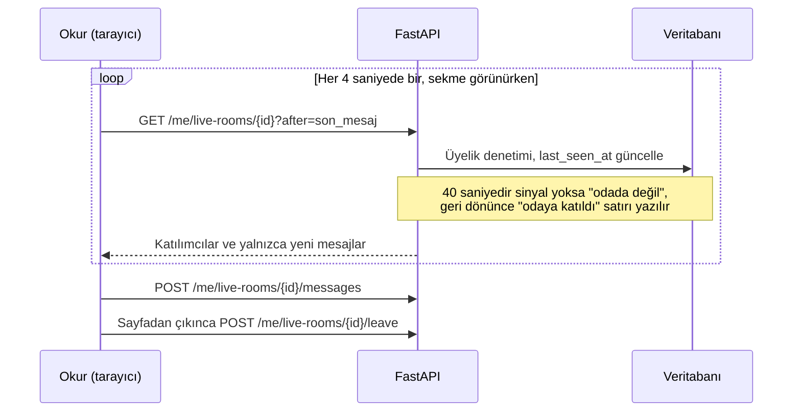

### Test, yayın ve zamanlanmış işler

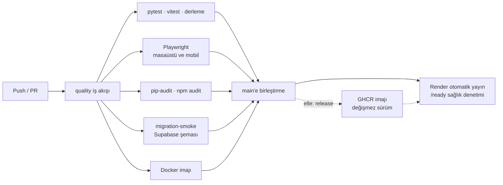

| Zamanlanmış iş | Sıklık | Ne yapar |
| --- | --- | --- |
| Okuma hatırlatmaları | 15 dakikada bir | Zamanı gelen hatırlatmaları e-posta ve web push ile gönderir |
| Veri saklama | Her gün 01:10 (UTC) | Süresi dolan olay kayıtlarını, okunmuş bildirimleri ve eski asistan sohbetlerini siler |
| Şifreli yedek | Her gün 00:00 (UTC) | Supabase veritabanının mantıksal yedeğini alır |
| Fiyat hattı (n8n) | Her gün 04:15 | Mağaza fiyatlarını yeniler ve fiyat tahminlerini günceller |

## Proje yapısı

```text
Mihenk/
├── backend/          # Python API, servisler, veritabanı ve testler
├── frontend/         # React / TypeScript arayüzü
├── infra/            # Docker Compose, Caddy ve n8n
├── docs/             # Rehberler ve görseller
├── .github/          # CI/CD iş akışları
├── Dockerfile        # Uygulama imajı
├── render.yaml       # Render dağıtımı
└── README.md
```

Git ve Docker'ın kullandığı üç gizli ayar dosyası da kökte bulunur.
[Ayrıntılı klasör rehberi](docs/project-structure.md).

## Geliştirme

Python 3.12 ve Node.js 22 kullanılır. Aşağıdaki iki komut grubu ayrı
terminallerde, depo kökünden başlatılır.

**Backend:**

```powershell
cd backend
python -m venv .venv
.venv\Scripts\Activate.ps1
python -m pip install -r requirements.lock.txt
uvicorn app.main:app --host 127.0.0.1 --port 8010
```

macOS/Linux üzerinde sanal ortamı `source .venv/bin/activate` ile etkinleştirin.
İsteğe bağlı yerel ayarlar için `backend/.env.example` dosyasını `backend/.env`
olarak kopyalayın.

**Frontend:**

```powershell
cd frontend
npm ci
npm run build      # React uygulamasını derler
npm run dev        # değişiklikte yeniden derler (backend açıkken)
```

Derleme `backend/app/static/generated/` klasörüne yazılır ve uygulama `/`
adresinde açılır. Açık ve koyu tema desteklenir; varsayılan olarak sistem ayarı
izlenir. Windows'ta `backend\run-local.bat` dosyasına çift tıklamak sanal ortamı
kurar ve sunucuyu başlatır. Yerel yönetici hesabı için `backend/.env` içine
`ADMIN_EMAILS=adres@ornek.com` yazın.
Uygulama [localhost:8010](http://127.0.0.1:8010) adresinde açılır.

Servis çalışanı ve "ana ekrana ekle" yalnızca `localhost` ya da HTTPS üzerinde
çalışır; telefonda yerel ağ IP'siyle denerken PWA özellikleri devre dışı kalır.

## Testler

Backend klasöründe `python -m pytest -q`, frontend klasöründe `npm test`
ve `npm run build` çalıştırılır. Uygulama açıkken frontend klasöründe
`npm run test:e2e` ile tarayıcı testleri çalıştırılır.

Tarayıcı testleri; iki ayrı kullanıcıyla canlı oda akışını (davet, katılımcı
listesi, sohbet, odadan çıkarma) ve servis çalışanının çevrimdışı açılışını da
kapsar. CI ayrıca `pip-audit` ve `npm audit` ile bağımlılık güvenlik taraması
yapar.

## Veritabanı değişiklikleri

Yerel geliştirmede SQLite şeması (`backend/database/schema.sql`) uygulama
açılırken kendiliğinden kurulur. Production'daki Supabase için değişiklikler
`backend/supabase/migrations/` klasöründedir ve kod yayınlanmadan önce
uygulanır: Supabase › SQL Editor'da dosyanın içeriği çalıştırılır ya da
`backend/` içinden `supabase db push` kullanılır.

| Migration | İçerik |
| --- | --- |
| `20260904135204_production_security_hardening.sql` | Güvenlik sıkılaştırması |
| `20260905123206_request_boundary_hardening.sql` | İstek sınırı korumaları |
| `20260907144425_single_active_club_read.sql` | Kulüp başına tek aktif kitap |
| `20261101140000_live_rooms.sql` | Canlı odalar: oda, üye ve mesaj tabloları |

## Dağıtım ve kullanım

- [Dağıtım rehberi](docs/deployment.md)
- [Kayıt ve admin davetleri](docs/registration-and-invitations.md)
- [İşletim notları](docs/operations.md)

Docker imajı depo kökünden `docker build -t mihenk .` ile oluşturulur.
Render aynı kök `Dockerfile` dosyasını kullanır.


## Landing Page


<p align="center">
  
</p>
