# Mihenk

<p align="center"></p>

Mihenk; kişiselleştirilmiş kitap önerileri, kitaplık yönetimi, okuma takibi,
alıntılar ve fiyat alarmları sunan bir web uygulamasıdır. Telefona uygulama
gibi kurulabilir (PWA) ve arkadaşlarla birlikte okumak ya da ders çalışmak için
canlı odalar sunar.

## Özellikler

- **Ruh hâline göre öneri:** "Yağmurlu bir akşam için kısa ve gizemli bir şey"
  gibi serbest bir cümleden, karakter, tema ve okuma geçmişine göre sıralanmış
  öneriler ve her önerinin neden uygun olduğu.
- **Kitaplık ve okuma takibi:** okuyorum / okuyacağım / okudum rafları, sayfa
  ilerlemesi, kişisel kitaplar, barkodla (ISBN) kitap ekleme ve Goodreads içe
  aktarma.
- **Odak modu:** Pomodoro sayacıyla okuma seansları, okurken alıntı kaydetme,
  okuma hızı ve toplam süre.
- **Rozetler ve okuma takvimi:** seriler, seviyeler, yıllık hedef ve rozet
  vitrini; yeni kazanılan rozet konfeti ve paylaşılabilir kartla kutlanır.
- **Yıllık okuma özeti:** okunan sayfalar, en sevilen tür, en uzun
  seri ve okur tipi; hikâye formatında kart kart paylaşılır.
- **Alıntı kartları:** kitaptan alıntıyı kapağın renkleriyle
  hikâye ya da gönderi boyutunda görsele çevirip paylaşma.
- **Topluluk:** kitaplara puan ve yorum, spoiler gizleme, faydalı bulma ve
  okurları takip etme.
- **Kitap kulüpleri:** ortak kitap, spoiler korumalı tartışmalar, ortak
  ilerleme, etkinlikler, oylamalar ve okuma odası.
- **Canlı odalar:** arkadaşlarla aynı anda okuma ya da ders çalışma; kamera ve
  mikrofon yoktur, katılım davet bağlantısı ya da kodla olur.
- **Kitap asistanı:** yapay zekâ destekli sohbet; rafa ekleme gibi işlemleri
  yalnızca kullanıcının onayıyla yapar.
- **Fiyatlar ve alarmlar:** kitap açıldığında izinli mağazalarda canlı fiyat
  araması (sonuçlar mağaza mağaza düşer), günlük otomatik tarama ve hedef
  fiyata düşünce bildirim.
- **Bildirimler ve hatırlatmalar:** uygulama içi bildirimler ve web push ile
  okuma hatırlatmaları.
- **Yönetim paneli:** kullanıcılar, yorum şikâyetleri, katalog, fiyat hattı ve
  kalite değerlendirmesi; yalnızca yönetici hesaplarına açıktır.
- **Gizlilik:** verileri indirme ve hesabı silme Ayarlar'dan yapılır.

## Ekran görüntüleri

<table>
  <tr>
    <td width="50%" valign="top">
      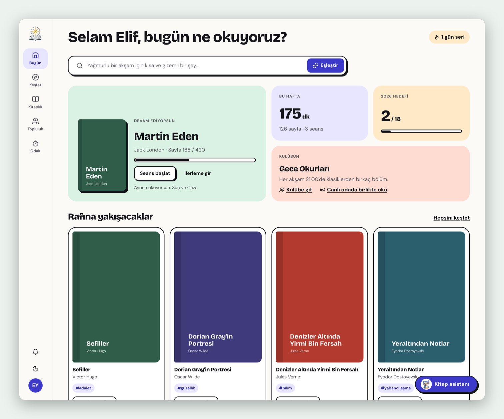<br>
      <b>Bugün</b><br>
      Günün başlangıcı: kaldığın kitap ve ilerlemen, bu haftaki okuma süren, yıllık hedefin ve kulübün. Altında rafına göre seçilmiş öneriler.
    </td>
    <td width="50%" valign="top">
      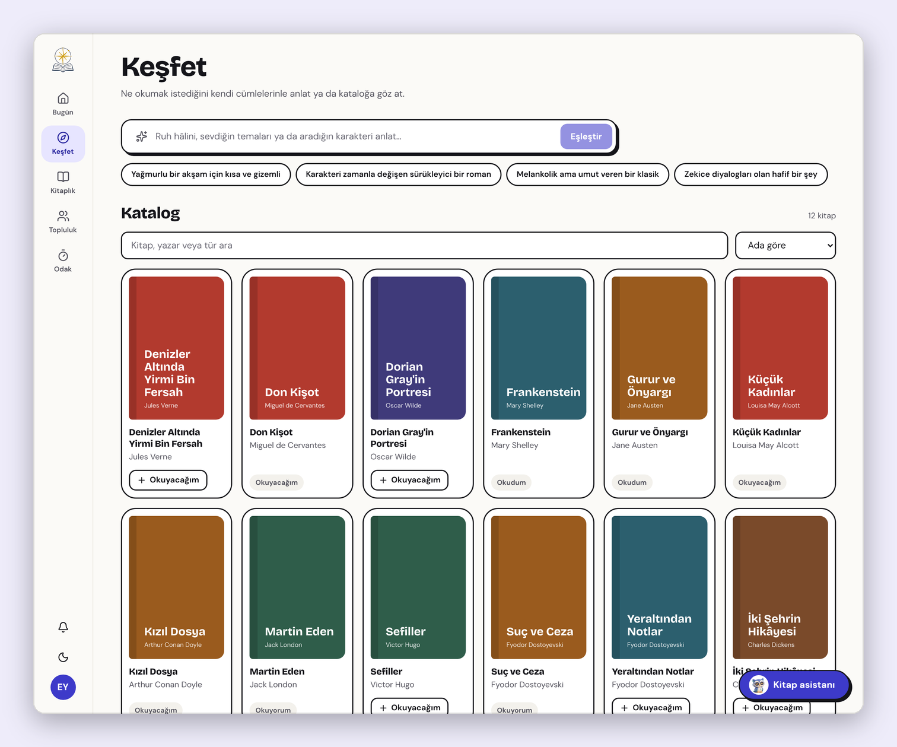<br>
      <b>Keşfet</b><br>
      Ne okumak istediğini kendi cümlenle anlatırsın; katalog da tür, yazar ve ada göre taranabilir. Her kitap bir uyum yüzdesiyle gelir.
    </td>
  </tr>
  <tr>
    <td width="50%" valign="top">
      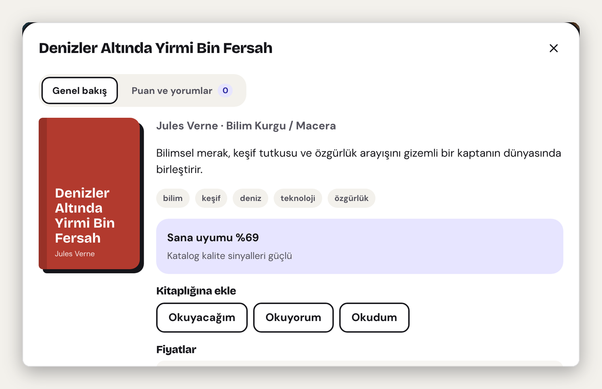<br>
      <b>Kitap ayrıntısı</b><br>
      Kitabın künyesi, temaları ve sana uyumu; tek dokunuşla rafa ekleme, mağaza fiyatları ve hedef fiyat alarmı.
    </td>
    <td width="50%" valign="top">
      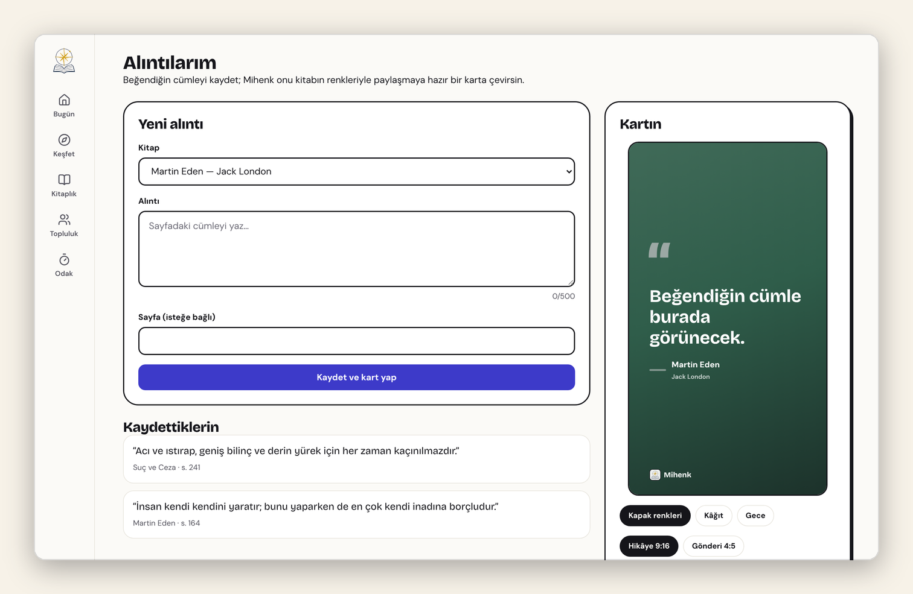<br>
      <b>Alıntılar</b><br>
      Okurken kaydettiğin alıntılar; kapağın renkleriyle paylaşılabilir karta dönüşür.
    </td>
  </tr>
  <tr>
    <td width="50%" valign="top">
      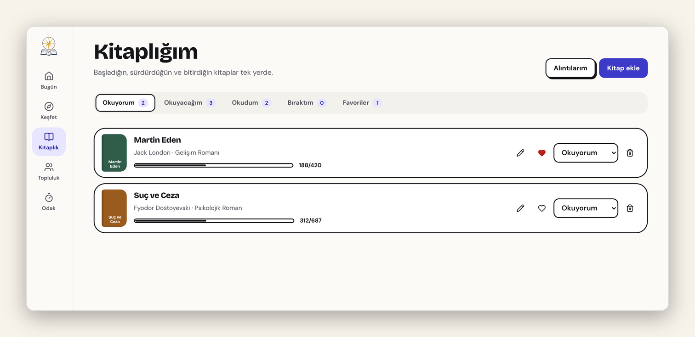<br>
      <b>Kitaplığım</b><br>
      Okuyorum, okuyacağım, okudum, bıraktım ve favoriler rafları; sayfa ilerlemesi her satırda görünür.
    </td>
    <td width="50%" valign="top">
      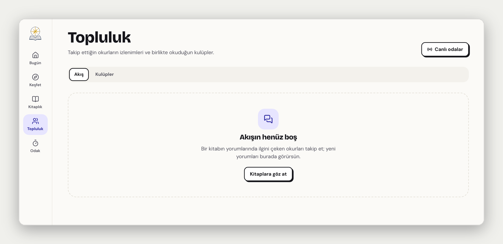<br>
      <b>Topluluk</b><br>
      Kitaplara puan ve yorum, spoiler gizleme ve takip ettiğin okurlar.
    </td>
  </tr>
  <tr>
    <td width="50%" valign="top">
      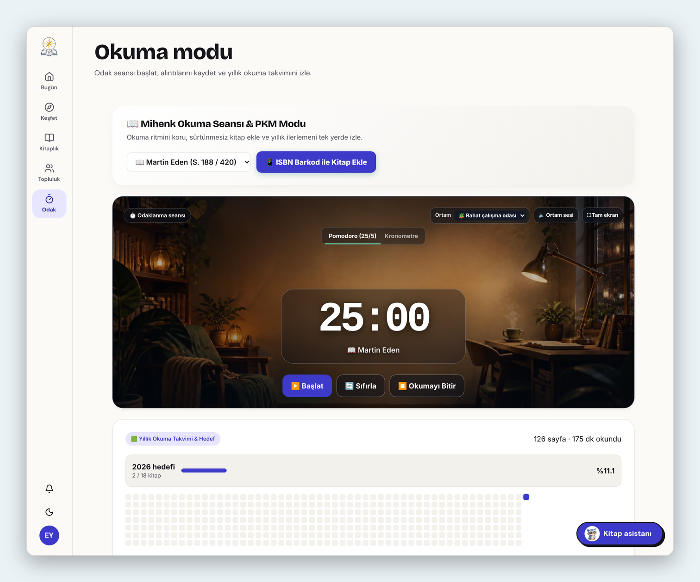<br>
      <b>Okuma modu</b><br>
      Pomodoro sayacı ve ortam seçimiyle okuma seansı; altında yıllık okuma takvimi ve hedef ilerlemesi.
    </td>
    <td width="50%" valign="top">
      <br>
      <b>Profil</b><br>
      Okuma istatistiklerin, rozetlerin ve yıllık hedefin bir arada.
    </td>
  </tr>
  <tr>
    <td width="50%" valign="top">
      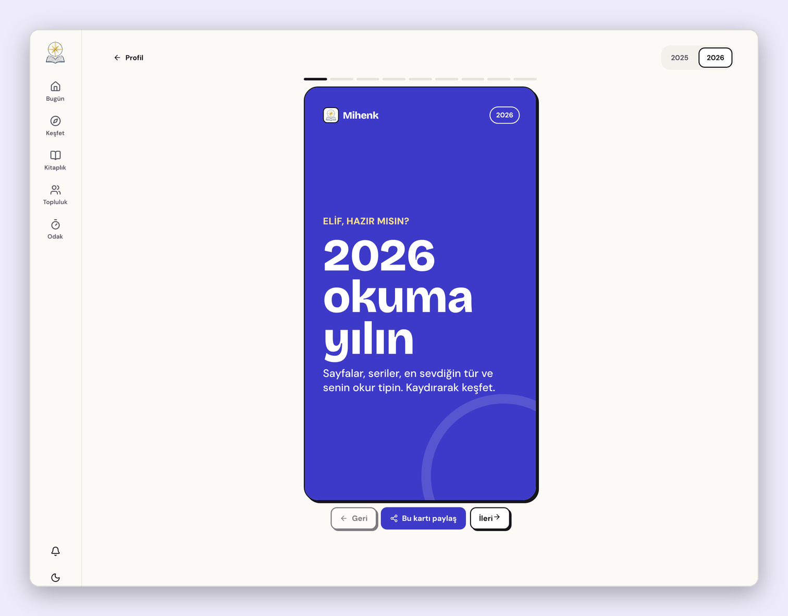<br>
      <b>Yıllık özet</b><br>
      Yılın okuma karnesi: sayfalar, en sevdiğin tür, en uzun serin ve okur tipin.
    </td>
    <td width="50%" valign="top">
      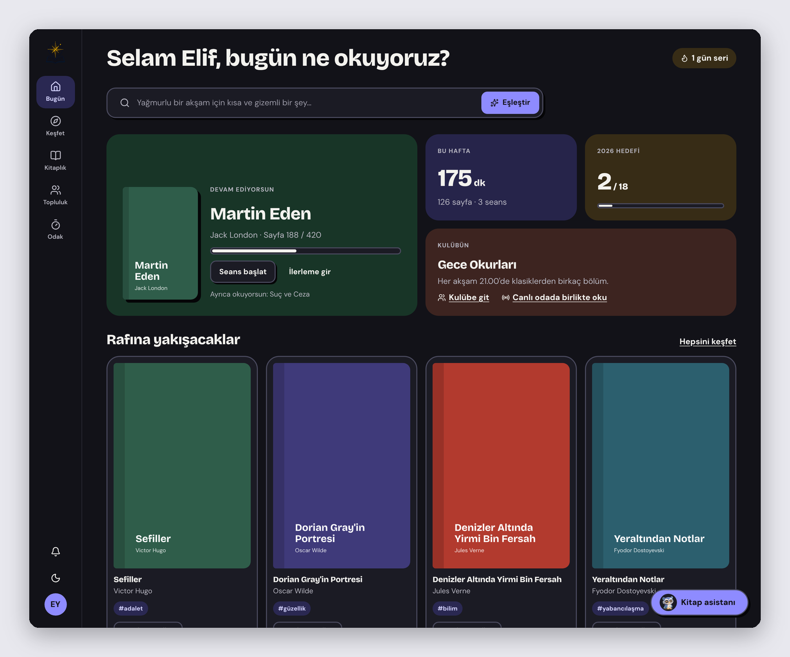<br>
      <b>Koyu tema</b><br>
      Tüm ekranlar koyu temayı destekler; varsayılan olarak sistem ayarı izlenir.
    </td>
  </tr>
  <tr>
    <td width="50%" valign="top">
      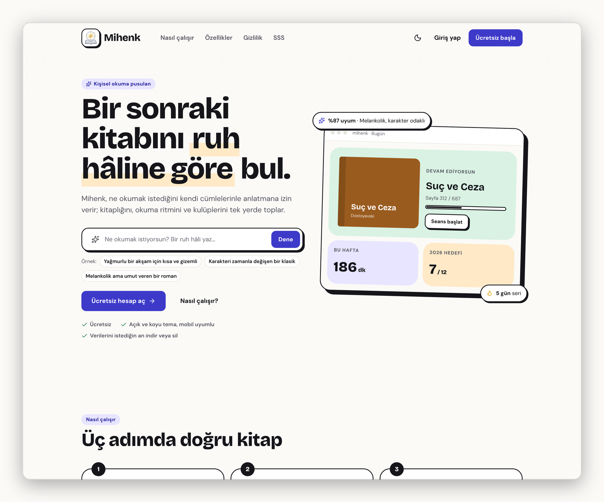<br>
      <b>Tanıtım sayfası</b><br>
      Giriş yapmadan görünen karşılama sayfası.
    </td>
  </tr>
</table>

## Telefonda uygulama olarak kullanma (PWA)

Mihenk ayrı bir mağaza uygulaması gerektirmeden telefonun ana ekranına
eklenebilir. Tam ekran açılır, kısayollarla (Bugün, Keşfet, Kitaplığım, Okuma
modu) başlatılır, bağlantı zayıfken de uygulama kabuğu açılır ve web push
bildirimleri gelir.

- **Android / bilgisayar (Chrome, Edge, Samsung Internet):** Bugün ekranındaki
  "Mihenk'i ana ekranına ekle" kartından ya da tarayıcı menüsündeki
  "Uygulamayı yükle" seçeneğinden.
- **iPhone / iPad (Safari):** Paylaş › Ana Ekrana Ekle. Uygulama bu adımları
  kartta ve Ayarlar › Uygulama olarak kullan bölümünde gösterir.

Servis çalışanı sitenin kökünden (`/service-worker.js`) sunulur ve tüm
sayfaları kontrol eder. Manifest `backend/app/static/manifest.webmanifest`
dosyasındadır.

Telefon görüntüleri 390×844 telefon görünümünde alındı; kurulum kartları Android ve iPhone tarayıcılarının gördüğü hâlleriyle.

<table>
  <tr>
    <td width="50%" valign="top">
      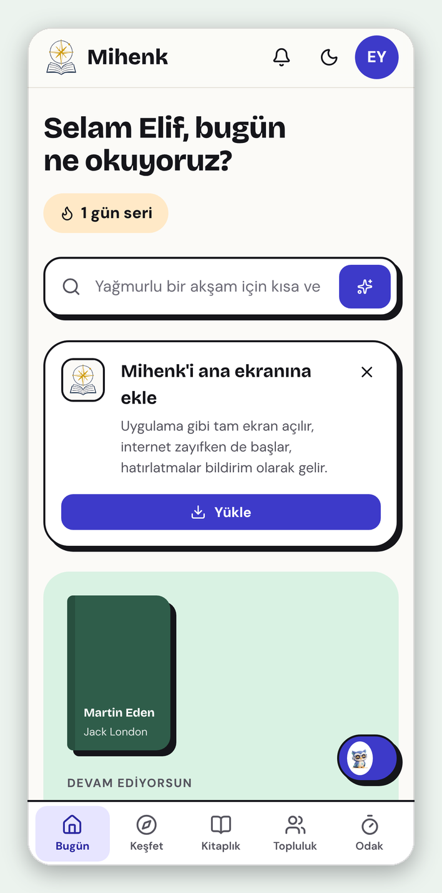<br>
      <b>Android: tek dokunuşla kurulum</b><br>
      Chrome, Edge ve Samsung Internet'te Bugün ekranında kart çıkar; “Yükle” tarayıcının kendi kurulum penceresini açar. Kart kapatılırsa bir süre gösterilmez.
    </td>
    <td width="50%" valign="top">
      <br>
      <b>iPhone: Ana Ekrana Ekle</b><br>
      Safari kurulum penceresi sunmadığı için kart iki adımı gösterir: Paylaş simgesi, ardından Ana Ekrana Ekle.
    </td>
  </tr>
  <tr>
    <td width="50%" valign="top">
      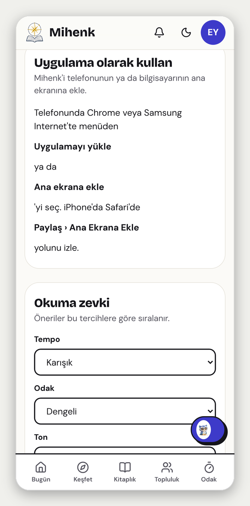<br>
      <b>Ayarlar › Uygulama olarak kullan</b><br>
      Kurulum durumu her zaman buradadır: yüklüyse bunu söyler, değilse cihaza uygun yolu anlatır.
    </td>
    <td width="50%" valign="top">
      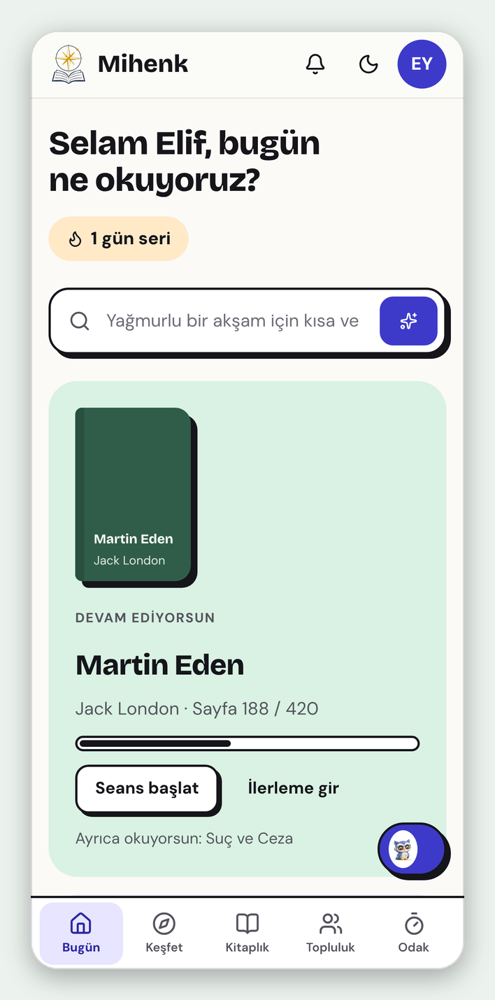<br>
      <b>Telefonda Bugün</b><br>
      Kaldığın kitap, ilerlemen ve günün önerileri tek sütunda; altta beş sekmeli gezinme çubuğu.
    </td>
  </tr>
  <tr>
    <td width="50%" valign="top">
      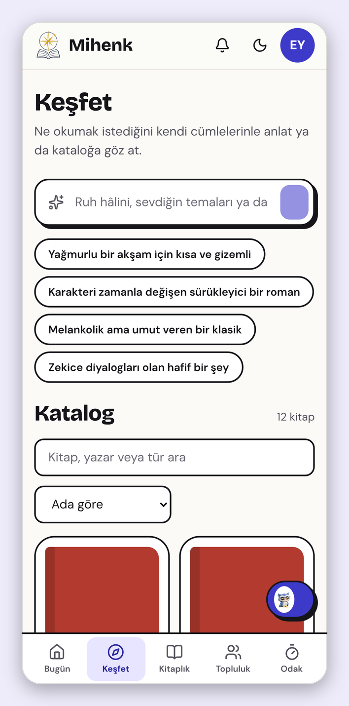<br>
      <b>Telefonda Keşfet</b><br>
      Öneriler ve katalog tek sütunda; arama kutusu üstte sabit kalır.
    </td>
    <td width="50%" valign="top">
      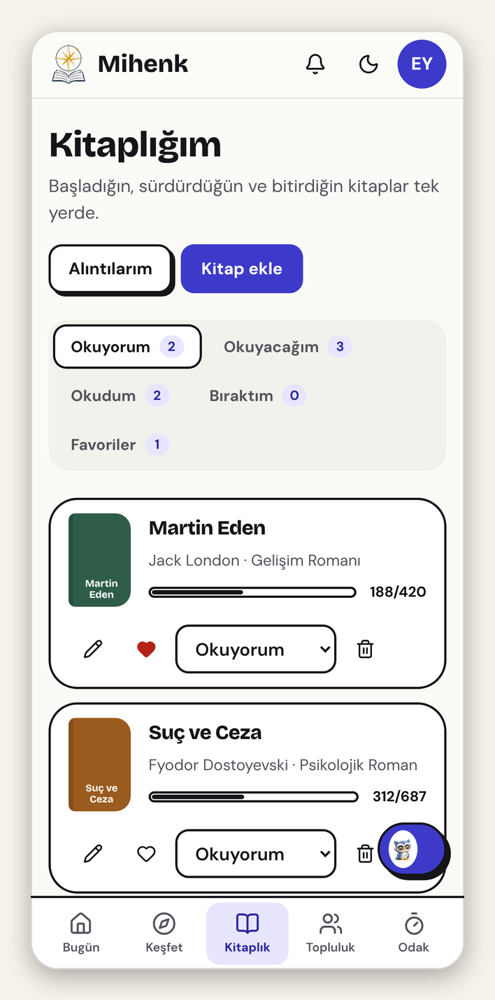<br>
      <b>Telefonda kitaplık</b><br>
      Raflar arasında yatay sekmelerle geçilir; her satırda sayfa ilerlemesi görünür.
    </td>
  </tr>
  <tr>
    <td width="50%" valign="top">
      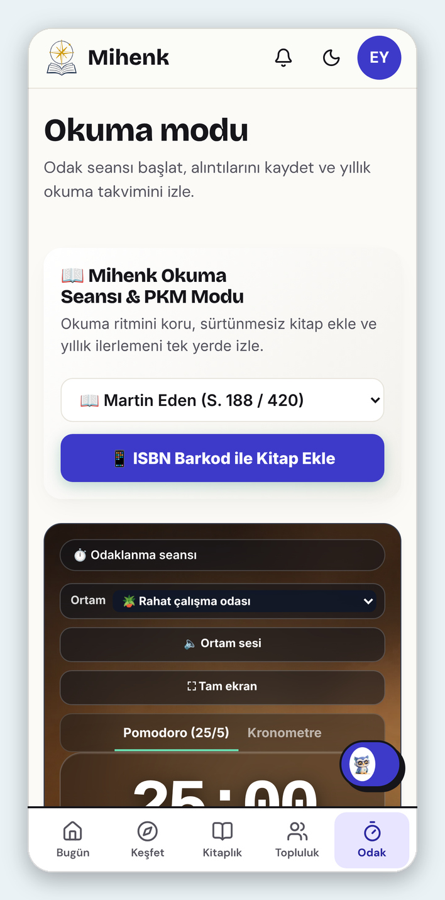<br>
      <b>Telefonda okuma modu</b><br>
      Kitap seçimi, barkodla kitap ekleme ve ortam ayarları; sayaç tam ekranda telefonu okuma saatine çevirir.
    </td>
    <td width="50%" valign="top">
      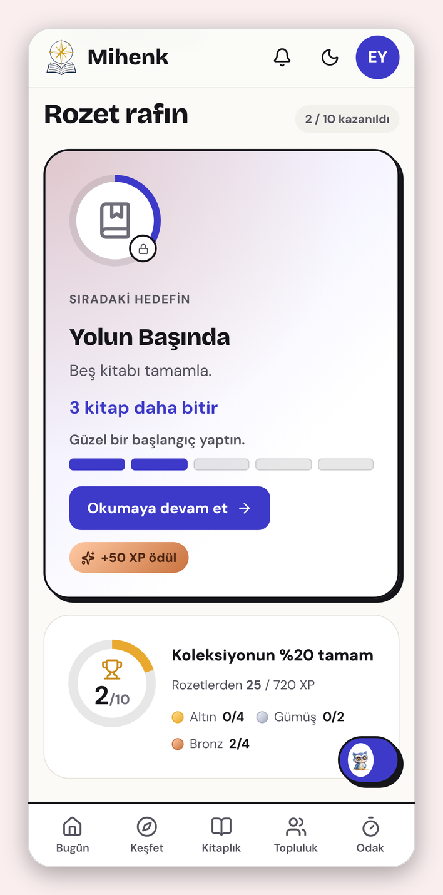<br>
      <b>Rozet rafı</b><br>
      Kazanılan ve sıradaki rozetler, ne kadar kaldığıyla birlikte.
    </td>
  </tr>
  <tr>
    <td width="50%" valign="top">
      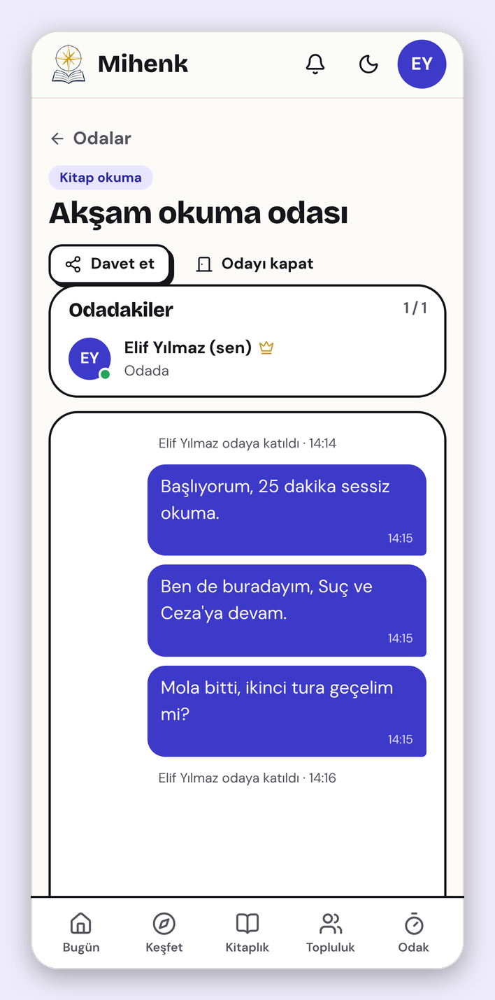<br>
      <b>Telefonda canlı oda</b><br>
      Katılımcılar üstte kısa bir liste, altında sohbet.
    </td>
    <td width="50%"></td>
  </tr>
</table>

iPhone’da bilmen gerekenler:

- Bildirimler iOS 16.4 ve sonrasında, yalnızca ana ekrana eklenmiş uygulamada
  gelir; Safari sekmesinde gelmez.
- Uygulama kapalıyken arka planda veri eşitlenmez.
- Uzun süre açılmayan sitelerin önbelleğini Safari silebilir; oturum sunucuda
  tutulduğu için en fazla yeniden giriş istenir.

## Sistem mimarisi

Mihenk tek bir Docker imajıdır: FastAPI sunucusu hem API'yi hem de derlenmiş
React uygulamasını aynı adresten sunar. Canlıda Render'da (Frankfurt) çalışır;
veriler ve kimlik doğrulama Supabase'de, hız sınırı ve metrikler Redis'te
tutulur. Yapay zekâ, katalog, e-posta ve fiyat kaynakları dış servislerdir;
zamanlanmış işler GitHub Actions üzerinde çalışır.

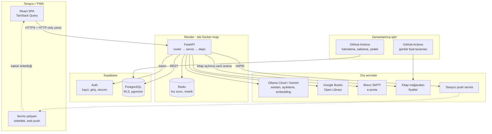

| Bileşen | Görevi | Kod |
| --- | --- | --- |
| React SPA | Tüm ekranlar; sunucu verisini TanStack Query ile önbelleğe alır ve yeniler | `frontend/src/spa`, `frontend/src/features` |
| Servis çalışanı ve manifest | Ana ekrana kurulum, uygulama kabuğunun önbelleği, web push bildirimleri | `backend/app/static/service-worker.js`, `manifest.webmanifest` |
| FastAPI | API, güvenlik katmanı (köken denetimi, hız sınırı), SPA'nın sunulması | `backend/app/main.py`, `backend/app/routers` |
| Servisler | Öneri ve arama, yapay zekâ, katalog, fiyat, okuma ve bildirim mantığı | `backend/app/services` |
| Depo katmanı | 13 alanlı veri sözleşmesi; yerelde SQLite, canlıda Supabase | `backend/app/repositories` |
| Supabase | PostgreSQL, satır düzeyinde güvenlik (RLS), kimlik doğrulama, vektör arama | `backend/supabase/migrations` |
| Redis | Dağıtık hız sınırı, e-posta gönderim koruması, metrikler | `backend/app/services/common/security.py` |
| GitHub Actions | Test ve güvenlik taraması, hatırlatmalar, veri saklama, günlük fiyat taraması, şifreli yedek, imaj yayını | `.github/workflows` |

Güvenlik, bu katmanların kendisine gömülüdür: oturumlar sunucuda doğrulanır,
her yetki denetimi API'de yapılır ve kullanıcıya ait veriler veritabanında satır
düzeyinde korunur. Uygulama ayrıca köken denetimi, hız sınırı ve standart
güvenlik başlıklarıyla gelir. Ayrıntılar bilerek burada anlatılmaz; ilgilenen
`backend/app/services/common/security.py` dosyasına bakabilir.

### Sunucunun katmanları

Her istek aynı yoldan geçer. Router'lar yalnızca HTTP ile ilgilenir; iş
kuralları servislerde, veri erişimi depo katmanındadır. Depo katmanı bir
sözleşmeye (`contracts.py`) bağlıdır: aynı kod yerelde SQLite ile, canlıda
Supabase ile çalışır ve iki uygulama da aynı sözleşme testlerinden geçer.

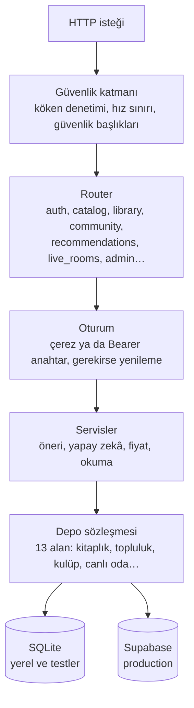

## Proje yapısı

```text
Mihenk/
├── backend/          # Python API, servisler, veritabanı ve testler
├── frontend/         # React / TypeScript arayüzü
├── infra/            # Docker Compose, Caddy ve n8n
├── docs/             # Rehberler ve görseller
├── .github/          # CI/CD iş akışları
├── Dockerfile        # Uygulama imajı
├── render.yaml       # Render dağıtımı
└── README.md
```

Git ve Docker'ın kullandığı üç gizli ayar dosyası da kökte bulunur.
[Ayrıntılı klasör rehberi](docs/project-structure.md).

## Geliştirme

Python 3.12 ve Node.js 22 kullanılır. Aşağıdaki iki komut grubu ayrı
terminallerde, depo kökünden başlatılır.

**Backend:**

```powershell
cd backend
python -m venv .venv
.venv\Scripts\Activate.ps1
python -m pip install -r requirements.lock.txt
uvicorn app.main:app --host 127.0.0.1 --port 8010
```

macOS/Linux üzerinde sanal ortamı `source .venv/bin/activate` ile etkinleştirin.
İsteğe bağlı yerel ayarlar için `backend/.env.example` dosyasını `backend/.env`
olarak kopyalayın.

**Frontend:**

```powershell
cd frontend
npm ci
npm run build      # React uygulamasını derler
npm run dev        # değişiklikte yeniden derler (backend açıkken)
```

Derleme `backend/app/static/generated/` klasörüne yazılır ve uygulama `/`
adresinde açılır. Açık ve koyu tema desteklenir; varsayılan olarak sistem ayarı
izlenir. Windows'ta `backend\run-local.bat` dosyasına çift tıklamak sanal ortamı
kurar ve sunucuyu başlatır. Yerel yönetici hesabı için `backend/.env` içine
`ADMIN_EMAILS=adres@ornek.com` yazın.
Uygulama [localhost:8010](http://127.0.0.1:8010) adresinde açılır.

Servis çalışanı ve "ana ekrana ekle" yalnızca `localhost` ya da HTTPS üzerinde
çalışır; telefonda yerel ağ IP'siyle denerken PWA özellikleri devre dışı kalır.

## Testler

Backend klasöründe `python -m pytest -q`, frontend klasöründe `npm test`
ve `npm run build` çalıştırılır. Uygulama açıkken frontend klasöründe
`npm run test:e2e` ile tarayıcı testleri çalıştırılır.

Tarayıcı testleri; iki ayrı kullanıcıyla canlı oda akışını (davet, katılımcı
listesi, sohbet, odadan çıkarma) ve servis çalışanının çevrimdışı açılışını da
kapsar. CI ayrıca `pip-audit` ve `npm audit` ile bağımlılık güvenlik taraması
yapar.

## Veritabanı değişiklikleri

Yerel geliştirmede SQLite şeması (`backend/database/schema.sql`) uygulama
açılırken kendiliğinden kurulur. Production'daki Supabase için değişiklikler
`backend/supabase/migrations/` klasöründedir ve kod yayınlanmadan önce
uygulanır: Supabase › SQL Editor'da dosyanın içeriği çalıştırılır ya da
`backend/` içinden `supabase db push` kullanılır.

| Migration | İçerik |
| --- | --- |
| `20260904135204_production_security_hardening.sql` | Güvenlik sıkılaştırması |
| `20260905123206_request_boundary_hardening.sql` | İstek sınırı korumaları |
| `20260907144425_single_active_club_read.sql` | Kulüp başına tek aktif kitap |
| `20261101140000_live_rooms.sql` | Canlı odalar: oda, üye ve mesaj tabloları |

## Dağıtım ve kullanım

- [Dağıtım rehberi](docs/deployment.md)
- [Kayıt ve admin davetleri](docs/registration-and-invitations.md)
- [İşletim notları](docs/operations.md)

Docker imajı depo kökünden `docker build -t mihenk .` ile oluşturulur.
Render aynı kök `Dockerfile` dosyasını kullanır.


